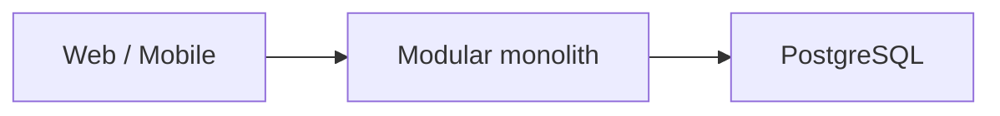
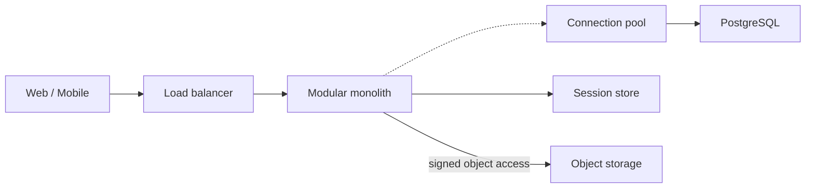
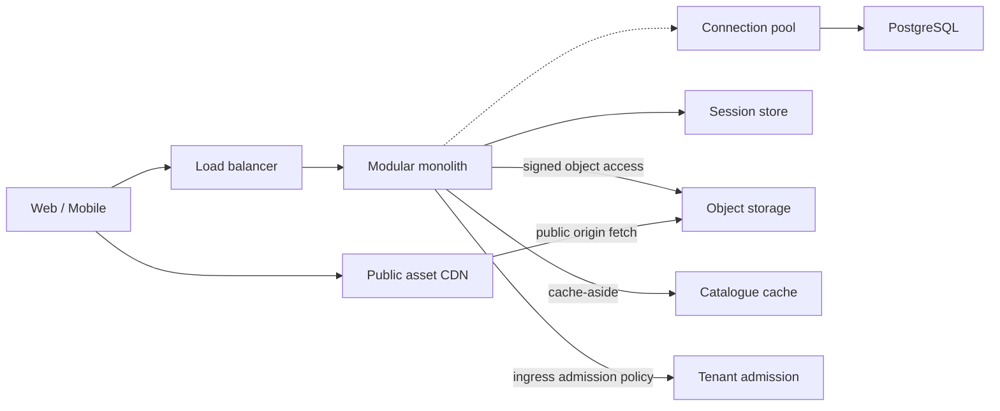
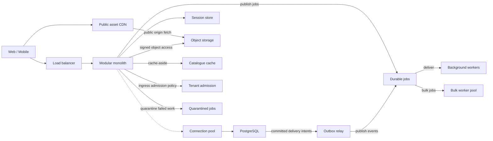
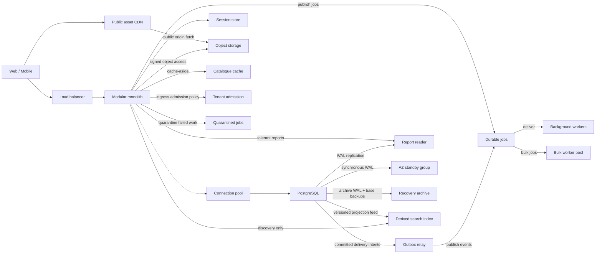
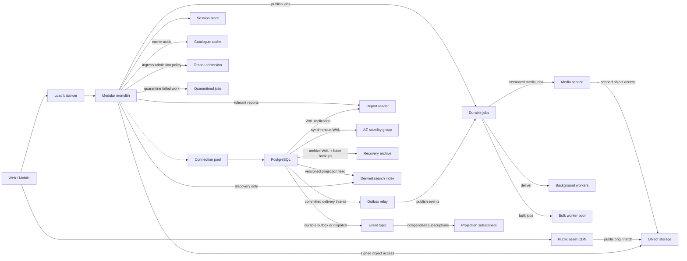
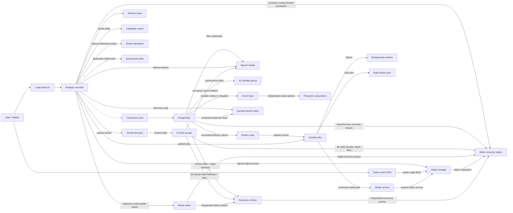

# Startup CTO campaign implementation report

Startup CTO now contains **36 playable levels, 108 choices, six eras, 18 conditional incident variants and 16 explicitly priced prerequisite repairs**. Cartline remains one company with one monthly decision ledger. Levels 1–3 retain their original source, IDs and effects. Existing healthy three-level saves continue into Level 4 without a reset; failed saves remain failed.

The [progression plan](startup-cto-progression.md) was written before content implementation. The [technical review](startup-cto-technical-review.md) records the pre-implementation findings and subsequent corrections. No additional agents, browser automation, new application framework or real infrastructure deployment were used.

## Campaign overview

| Era | Levels | Educational objective |
|---|---:|---|
| Production Monolith | 1–6 | Diagnose the actual resource; scale app compute, then make sessions and files independent of hosts. |
| Read Scaling and Delivery | 7–12 | Justify caching with reuse, define freshness, improve public delivery, enforce fairness and prevent stampedes. |
| Asynchronous Systems | 13–18 | Separate critical work from durable deferred work; handle duplicates, retries, poison messages, atomic handoff and starvation. |
| Database and Data Scaling | 19–24 | Scale eligible reads, preserve workflow consistency, rehearse failover/restores and evolve data safely. |
| Service and Event Architecture | 25–30 | Extract only an earned domain; contain dependencies, define event semantics and diagnose distributed latency. |
| Millions of Users | 31–36 | Distinguish lifecycle partitioning from write sharding; handle skew, regional recovery and a finite launch contract. |

## Level map

Every new level offers a recommended response, a technically defensible narrower compromise, and a plausible engineering mistake. Recommendations are specific to the scenario’s workload, contract and team.

| Level | Title | Incident | Main lesson | Architecture introduced / changed on recommended route |
|---:|---|---|---|---|
| 1 | Your First Day | Founder requests a rewrite | Keep a simple deploy until evidence justifies change | Modular Laravel monolith |
| 2 | The Dashboard Is Slow | Expensive order scan | Fix the query before buying capacity | Query-aligned PostgreSQL index |
| 3 | Too Many Connections | 498 of 500 sessions | Pool the resource that is exhausted | Connection pooler |
| 4 | [The Influencer Weekend](../src/campaigns/startup-cto/levels/level-004.ts) | Influencer traffic saturates app CPU | Scale the saturated tier; load balancing does not make application state portable. | app fleet, indexed, pooled |
| 5 | [Logged Out at Random](../src/campaigns/startup-cto/levels/level-005.ts) | Local sessions fail across hosts | Stateless application instances require deliberate placement of session state. | portable sessions |
| 6 | [The Missing Product Photos](../src/campaigns/startup-cto/levels/level-006.ts) | Uploads live on disposable disks | Externalize durable files before treating application hosts as disposable. | durable media |
| 7 | [The Same Catalogue Again](../src/campaigns/startup-cto/levels/level-007.ts) | Repeated indexed catalogue reads | Cache only data whose reuse and freshness contract justify it. | catalogue cache |
| 8 | [Yesterday’s Price](../src/campaigns/startup-cto/levels/level-008.ts) | Merchant edits outlive cache freshness | Cache invalidation is a consistency contract, including races and failed invalidations. | fresh catalogue |
| 9 | [A Storefront Across the Ocean](../src/campaigns/startup-cto/levels/level-009.ts) | Distant public-asset origin | Edge delivery improves cacheable content; it does not make private APIs safe to cache. | edge assets, durable media |
| 10 | [The Scraper Next Door](../src/campaigns/startup-cto/levels/level-010.ts) | Noisy authenticated integration | Fair admission is part of availability; quota scope matters. | tenant limits |
| 11 | [Capacity Arrives Too Late](../src/campaigns/startup-cto/levels/level-011.ts) | Hosts start after the promotion spike | Autoscaling needs lead time, bounded downstream budgets and evidence from load tests. | app fleet, portable sessions, durable media, bounded autoscale |
| 12 | [Everyone Misses Together](../src/campaigns/startup-cto/levels/level-012.ts) | Concurrent fills at synchronized expiry | Coalesce expensive work and bound staleness rather than merely making caches bigger. | catalogue cache, cache coalescing |
| 13 | [The Receipt Holds the Checkout](../src/campaigns/startup-cto/levels/level-013.ts) | Receipts hold checkout open | Move deferrable work behind a durable handoff; asynchronous does not mean unreliable. | job queue |
| 14 | [Two Receipts for One Order](../src/campaigns/startup-cto/levels/level-014.ts) | Crash after external effect, before acknowledgement | Deduplication must cover the side effect, not just the queue message. | idempotent effects |
| 15 | [Retrying the Provider to Death](../src/campaigns/startup-cto/levels/level-015.ts) | 429 retries amplify overload | Retries consume capacity; budget them and add jitter. | bounded retries |
| 16 | [One Message Never Finishes](../src/campaigns/startup-cto/levels/level-016.ts) | Malformed event starves healthy work | Quarantine poison work with evidence and a safe replay path. | dead letter |
| 17 | [Paid Order, Missing Event](../src/campaigns/startup-cto/levels/level-017.ts) | Crash between commit and publish | Transactional outbox closes a dual-write gap but still needs idempotent consumers. | outbox, job queue |
| 18 | [The Import Ate the Receipts](../src/campaigns/startup-cto/levels/level-018.ts) | Bulk imports starve receipts | Queues need class isolation, backpressure and bounded admission. | isolated workers |
| 19 | [Every Merchant Has a Dashboard](../src/campaigns/startup-cto/levels/level-019.ts) | Low-reuse personalized reports saturate primary | Read replicas scale eligible reads, not write throughput. | read replicas |
| 20 | [The Order That Disappeared](../src/campaigns/startup-cto/levels/level-020.ts) | Replica lookup misses a committed order | Consistency belongs to a workflow, not a blanket database label. | consistent reads |
| 21 | [A Zone Goes Dark](../src/campaigns/startup-cto/levels/level-021.ts) | Zone failover fails the order SLA | Define the failure domain and acknowledgement policy before promising RPO zero. | multi az |
| 22 | [The Delete Reached Every Replica](../src/campaigns/startup-cto/levels/level-022.ts) | Replicas copy a logical deletion | Backups count only when a measured restore satisfies the recovery objective. | pitr |
| 23 | [A Column Becomes an Outage](../src/campaigns/startup-cto/levels/level-023.ts) | Locks and incompatible rolling changes | Evolve schemas with overlapping compatibility and bounded migrations. | safe migrations |
| 24 | [Find the Red Shoe, Not a Substring](../src/campaigns/startup-cto/levels/level-024.ts) | Facets and relevance miss the search target | Use a derived specialized index when its semantics and measured workload justify it. | search projection |
| 25 | [One Domain Earns Its Own Deploy](../src/campaigns/startup-cto/levels/level-025.ts) | Media has distinct scale and release needs | Extract one stable domain when independent scale and ownership pay for the network boundary. | media service |
| 26 | [A Healthy Core Waiting on a Slow Edge](../src/campaigns/startup-cto/levels/level-026.ts) | Slow previews exhaust request slots | Timeouts, bulkheads and circuit breakers bound a dependency’s blast radius. | dependency bulkheads |
| 27 | [One Event, Three Different Jobs](../src/campaigns/startup-cto/levels/level-027.ts) | Competing consumers divide required events | Choose messaging semantics for the consumer relationship. | event fanout |
| 28 | [The Field That Broke Three Teams](../src/campaigns/startup-cto/levels/level-028.ts) | Money-unit change breaks consumers | Event compatibility includes meaning, units, ordering and old retained data. | versioned events |
| 29 | [Everything Looks Green](../src/campaigns/startup-cto/levels/level-029.ts) | Green CPU hides a broken journey | Observe the user journey with correlated signals and actionable ownership. | observability |
| 30 | [The Payment Provider’s Long Tail](../src/campaigns/startup-cto/levels/level-030.ts) | Provider timeout leaves payment unknown | A timeout is an unknown result; payment correctness needs stable identity and reconciliation. | payment reconciliation |
| 31 | [Retention Becomes the Workload](../src/campaigns/startup-cto/levels/level-031.ts) | Retention and vacuum dominate history | Partition for pruning and lifecycle management; it is not automatically sharding. | time partitions |
| 32 | [One Writer Has Reached Its Budget](../src/campaigns/startup-cto/levels/level-032.ts) | Optimized writer reaches its affordable limit | Shard only with a measured writer limit and a transaction-local key. | tenant shards |
| 33 | [The Whale Does Not Hash Smaller](../src/campaigns/startup-cto/levels/level-033.ts) | One tenant dominates a writer group | Hot tenants require isolation or a proven sub-key, not another hash function. | whale isolation |
| 34 | [The Region Is Unreachable](../src/campaigns/startup-cto/levels/level-034.ts) | Cold restore misses regional RTO | Regional architecture follows RPO/RTO and conflict semantics, not a universal active-active ideal. | regional dr |
| 35 | [Protect the Checkout, Shed the Rest](../src/campaigns/startup-cto/levels/level-035.ts) | Offered work exceeds recovery capacity | Admission control and graceful degradation protect explicit priorities within finite capacity. | load shedding |
| 36 | [The Cartline Launch Review](../src/campaigns/startup-cto/levels/level-036.ts) | Integrated capacity, consistency and recovery review | The simplest acceptable architecture is the one demonstrated to meet the workload and business contract. | launch reviewed |

## Architecture evolution

These diagrams are generated from the **actual recommended-choice graph** after each milestone, not a replacement graph shown to every player. Logical groups such as the eight writer groups encapsulate per-group pooling, high availability and recovery. Admission-policy, replication and recovery links are distinguished by their labels; they are not all synchronous request hops. Retained components on alternate routes remain visible in the live ending.

The startup opens with `Web / Mobile → Laravel → PostgreSQL`. Later policy capabilities (for example idempotency, schema compatibility, telemetry and load shedding) are listed alongside topology rather than drawn as fictitious services.

| After level | Registered users | Engineers | Cash | Monthly revenue | Monthly burn |
|---:|---:|---:|---:|---:|---:|
| 1 | 18,000 | 2 | $34,200 | $8,000 | $7,800 |
| 6 | 55,000 | 3 | $44,400 | $26,500 | $14,300 |
| 12 | 280,000 | 5 | $218,000 | $112,000 | $33,100 |
| 18 | 760,000 | 8 | $1,008,900 | $315,000 | $65,100 |
| 24 | 1,750,000 | 12 | $3,063,800 | $690,000 | $131,100 |
| 30 | 2,950,000 | 19 | $7,163,200 | $1,245,000 | $236,100 |
| 36 | 4,000,000 | 27 | $13,954,600 | $1,950,000 | $408,100 |

### After Level 1

### After Level 6

Recorded contracts and practices: app fleet, indexed, pooled, portable sessions, session store, durable media, object media.

### After Level 12

Recorded contracts and practices: app fleet, indexed, pooled, portable sessions, session store, durable media, object media, catalogue cache, fresh catalogue, edge assets, tenant limits, bounded autoscale, capacity budget, cache coalescing.

### After Level 18

Recorded contracts and practices: app fleet, indexed, pooled, portable sessions, session store, durable media, object media, catalogue cache, fresh catalogue, edge assets, tenant limits, bounded autoscale, capacity budget, cache coalescing, job queue, idempotent effects, bounded retries, dead letter, outbox, durable handoff, isolated workers.

### After Level 24

Recorded contracts and practices: app fleet, indexed, pooled, portable sessions, session store, durable media, object media, catalogue cache, fresh catalogue, edge assets, tenant limits, bounded autoscale, capacity budget, cache coalescing, job queue, idempotent effects, bounded retries, dead letter, outbox, durable handoff, isolated workers, read replicas, reader routing, consistent reads, multi az, pitr, safe migrations, search projection.

### After Level 30

Recorded contracts and practices: app fleet, indexed, pooled, portable sessions, session store, durable media, object media, catalogue cache, fresh catalogue, edge assets, tenant limits, bounded autoscale, capacity budget, cache coalescing, job queue, idempotent effects, bounded retries, dead letter, outbox, durable handoff, isolated workers, read replicas, reader routing, consistent reads, multi az, pitr, safe migrations, search projection, media service, media owned, dependency bulkheads, event fanout, reliable projections, versioned events, observability, payment reconciliation.

### After Level 36

Recorded contracts and practices: app fleet, indexed, pooled, portable sessions, session store, durable media, object media, catalogue cache, fresh catalogue, edge assets, tenant limits, bounded autoscale, capacity budget, cache coalescing, job queue, idempotent effects, bounded retries, dead letter, outbox, durable handoff, isolated workers, read replicas, reader routing, consistent reads, multi az, pitr, safe migrations, search projection, media service, media owned, dependency bulkheads, event fanout, reliable projections, versioned events, observability, payment reconciliation, time partitions, tenant shards, distributed ids, whale isolation, regional dr, load shedding, priority admission, launch reviewed, launch qualified.

## Branching and persistent state

- Levels 5–6 distinguish an existing app fleet from single-host replacement rehearsals. Level 11 prices missing portable sessions and durable files before a fleet rollout.
- Levels 8 and 12 distinguish a deployed catalogue cache from a bypassed/omitted cache. Choosing direct reads disables the active cache capability. Reintroduction records its own rollout rather than restoring an idealized diagram.
- Levels 14, 16–18 cover local delivery/reconciliation when no job queue exists. Automatic retries require a priced idempotency repair if it was omitted; outbox/worker choices explicitly provision missing durable jobs.
- Level 20 distinguishes production replica routing from a proposed mobile-reader test. Returning to primary reads disables replica routing while retaining purchased reader infrastructure.
- Level 22 does not assume synchronous availability infrastructure was built. Level 24 prices a missing transactional projection feed; Level 25 prices missing media job/object boundaries.
- Level 26 distinguishes an extracted media service from a blocking wait in shared workers. Level 27 uses a prototype when a queue/search projection was not deployed. Level 28 prices missing independent subscriber delivery. Level 30 uses temporary diagnostic spans if full observability was skipped.
- Level 32 separates write saturation from the chosen history layout. Level 33 handles the whale on either sharded or single-writer routes. Level 34 prices an independent restore archive; Level 35 distinguishes warm regional recovery from a slower restore tier.
- Level 36 resolves against saved capabilities and unresolved correctness hazards. A response cannot certify missing prerequisites by passing a forged base choice from the client. An honest constrained launch remains playable. Fixed peak capacity is accepted as an alternative to autoscaling, and media extraction/search/replicas are not mandatory technologies for every viable route.

Capabilities extend the existing graph; there is no second architecture object. Each accepted choice retains cash, recurring costs, growth, trust, health, confidence, XP, team size and topology. New history entries also store the incident description and before/after architecture snapshots. Shared replay resolves each previous response against its entering graph so paid repairs and conditional outcomes reproduce the original decision.

## System-design correctness and competing valid answers

- **Bigger host vs app fleet:** vertical capacity is a legitimate short-term response. The fleet is recommended for repeated events and replacement flexibility; portable state still needs separate work. The vertical compromise can pause contracted roadmap spend to restore runway after a costly opening mistake.
- **Server-side vs signed sessions:** both make app hosts replaceable. Short-lived signed cookies trade immediate per-session revocation for reduced server-side session dependency.
- **Object store vs managed filesystem:** both can make bytes survive hosts. Object storage is recommended for the subsequent public-delivery path; a filesystem preserves POSIX semantics at an operating cost.
- **Invalidation vs direct reads:** avoiding a cache is valid if capacity is funded. Version fences and expiry measured from source-read time prevent a late fill extending the promised freshness bound. Public descriptions may tolerate a longer stale window than prices or checkout stock.
- **Autoscaling vs fixed peak capacity:** both satisfy the capacity budget when properly tested. Autoscaling reduces idle cost; the fixed fleet can still earn the premium finale.
- **Provider idempotency vs human reconciliation:** keys work only when the relevant side effect honors them. Ambiguous delivery can instead be quarantined for review at a throughput/latency cost. No queue-level exactly-once guarantee is invented.
- **Outbox vs database dispatcher:** atomic order/delivery intent can be implemented using either. A topic plus subscriber queues is recommended for independent projections; a durable custom dispatcher remains viable.
- **Asynchronous vs synchronous standby:** async is valid for an agreed loss budget; it cannot satisfy zero acknowledged loss. Multi-AZ acknowledgement requires a durable remote WAL copy and fenced election, with write availability sacrificed when that safety condition fails. Regional catastrophe is a separate, explicitly weaker contract.
- **PostgreSQL search vs specialized index:** reduced facets/relevance can remain in PostgreSQL. The specialized projection wins the stated benchmark, but never owns checkout inventory.
- **Dedicated workers vs media service:** both isolate compute. Separate release cadence and funded ownership justify the service only on the recommended route; the modular core remains.
- **Time partitions vs shards:** retention/pruning is a lifecycle problem. Sharding comes only after measured write saturation, with tenant-local transactions, unique IDs, migration validation and per-group recovery. Hashing cannot divide a single hot tenant.
- **Warm standby vs cold restore:** either is defensible under the right recovery contract. Only the rehearsed warm system meets the 15-minute target; arbitrary active-active writes would require conflict semantics that Cartline has not designed.

Primary reference checks and caveats are recorded in the [technical review](startup-cto-technical-review.md), including [PostgreSQL replication](https://www.postgresql.org/docs/current/warm-standby.html), [partitioning](https://www.postgresql.org/docs/current/ddl-partitioning.html), [transactional outbox](https://docs.aws.amazon.com/prescriptive-guidance/latest/cloud-design-patterns/transactional-outbox.html), and [idempotent APIs](https://aws.amazon.com/builders-library/making-retries-safe-with-idempotent-APIs/).

## Tested balance and ending

The recommended route ends with **4,000,000 registered users, 27 engineers, $13,954,600 cash, $1,950,000 monthly recurring revenue and $408,100 monthly burn**. Reliability/trust are game scores at 100, and operational load is 10. Cost and complexity still attach to good decisions; several capacity additions award no direct reliability points. New revenue is collected only on the following turn.

The all-compromise route (after the original recommended opening) ends with **2,806,900 users, 27 engineers, $9,252,010 cash, $1,368,150 revenue and $358,755 burn**, with a constrained launch and its actual different topology. A fixed-capacity-only deviation can still qualify the premium contract. A single middle-game mistake is recoverable; repeated bad choices and the deliberately unsupported final launch can end the run.

The premium forecast is explicitly finite: 4M registered accounts / 400K DAU, 500 mean / 3,000 peak origin RPS, up to 12,000 public-delivery RPS, 200 peak orders/s and 24,000 peak row mutations/s including feeds. Six TB includes indexes/history/catalogue data, not image bytes. Checkout targets are p95 500ms, p99 1.5s and 99.9% monthly availability. Zone and regional failure contracts remain distinct. These are authored game scenarios and modeled rehearsals, not a performance claim about deployed software.

## Code changes

Created:

- `src/campaigns/startup-cto/levels/level-004.ts` through `level-036.ts`: 33 individually authored levels, linked from the level map above.
- `src/campaigns/startup-cto/levels/authoring.ts`: small content helpers for shared topology vocabulary and era labels.
- `src/campaigns/startup-cto/launchContract.ts`: shared premium prerequisites and unresolved correctness hazards.
- `src/domain/levelVariants.ts`: pure state-dependent resolution and explicit prerequisite pricing.
- `src/domain/campaignEnding.ts`: actual-architecture ending summary and qualification.
- `scripts/validate-campaign.cjs`: reproducible source-level full-route validation and JSON milestone output.
- `.eslintrc.js`: Expo’s standard lint configuration; lint was previously unconfigured.
- `docs/startup-cto-progression.md`, `docs/startup-cto-technical-review.md`, `docs/startup-cto-report.md`.

Modified:

- `src/campaigns/startup-cto/campaign.ts`: ordered 36-level manifest, actual campaign size and objective.
- `src/domain/types.ts`, `schemas.ts`, `architecture.ts`, `simulation.ts`: optional capabilities/variants/recovery metadata, finite-effect validation, immutable capability changes and engineer deltas.
- `src/store/gameStore.ts`: canonical state-dependent choice acceptance, consistent historical replay, resolved affordability checks and architecture snapshots; save version remains 5.
- `app/game/[levelId].tsx`: resolved briefing and full readable incident constraints alongside the existing scene.
- `app/outcome.tsx`: resolved historical choice details, hiring deltas, registered-user terminology and health-score units.
- `app/complete.tsx`: real campaign completion, actual topology, retained practices and missing prerequisites.
- `tests/game.test.cjs`: full campaign tests while retaining isolated fourth/fifth-level extension fixtures and opening regressions.
- `tests/audio.test.cjs`: Node test harness now stubs MP3 assets like WAV assets; without this pre-existing harness fix, the full suite tried to parse bundled background music as JavaScript.
- `package.json`, `package-lock.json`: required ESLint development dependencies and `validate:campaign` command. No new runtime dependencies.
- `README.md`, `docs/adding-levels.md`: current campaign and authoring/validation instructions.

Concurrent deployment configuration changes visible in the workspace were preserved; they were not authored as part of this campaign work. The published source files for Levels 1–3 remain unchanged.

## Validation

| Check | Result |
|---|---|
| `npm run typecheck` | Pass |
| `npm test` | 46 tests pass, including the six audio tests |
| `npm run lint` | Pass, zero errors; two existing unused-import warnings in `app/stats.tsx` and `src/ui/components/MetricStrip.tsx` |
| `npm run validate:campaign` | 36 levels / 108 choices / 18 variants / 16 repairs; recommended and compromise routes complete |
| `npm run build` | Pass; Expo web export includes 49 routes, including all 36 game-level routes |
| `git diff --check` | Pass |
| UI automation | Not used; source, engine, persistence and web-export checks were sufficient for this content/engine extension |

The test suite covers original opening choices, append/save compatibility, all five failure thresholds, unaffordable incidents, reset, migration, canonical acceptance of forged choices, preserved early service-split pooling, monthly charging, historical replay, hiring, graph integrity, finite/clamped state, each of the 99 new responses on an attempted full route, 120 deterministic mixed routes, alternate ending topology, final hazard rejection and valid fixed-capacity qualification. Deterministic samples are not an exhaustive traversal of 3^36 possible campaigns.

## Open product/design questions

No implementation blocker remains. These choices were made explicitly and can be tuned after player feedback:

1. **Economy difficulty:** the profitable recommended trajectory leaves substantial cash by the late game. Raising salary/sales costs, adding investment mechanics or tightening retention would materially change difficulty and needs product input, not an unannounced simulator rewrite.
2. **Commercial meaning:** registered shoppers and merchant recurring revenue are deliberately separate. A dedicated paying-merchant metric could make future economic scenarios richer; it is not inferred from DAU.
3. **Pacing:** one decision remains one operating month and each incident has three responses. Whether to add intermediate milestones, more dialogue or replay shortcuts is a product choice.
4. **Ending tiers:** supported compromises receive an honest constrained launch; the premium contract has conservative capability checks. Future viable architectures should be added as explicit equivalent contracts, as fixed capacity already is, instead of forcing technology collection.
5. **Verification limits:** workload/cost numbers are authored teaching assumptions, and the game does not execute infrastructure benchmarks. Device-specific visual playtesting remains useful for long briefings and large topology maps, but was not required to validate these changes.
